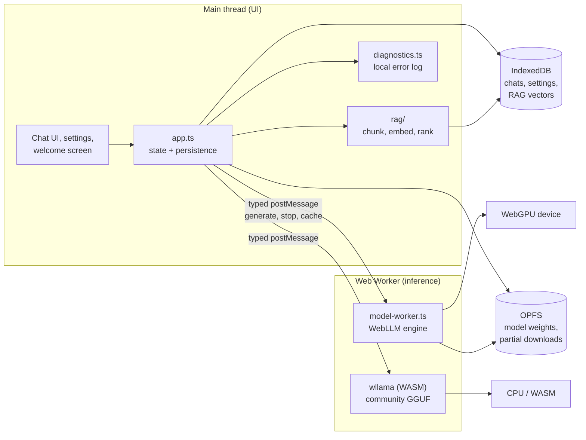

# LocalMind

[**Try the live demo →**](https://ashrafularefin78-prog.github.io/SERVERLESS-AI/) · [**Open it in StackBlitz →**](https://stackblitz.com/github/ashrafularefin78-prog/SERVERLESS-AI)

[](https://ashrafularefin78-prog.github.io/SERVERLESS-AI/)
[](https://github.com/ashrafularefin78-prog/SERVERLESS-AI/actions/workflows/ci.yml)
[](LICENSE)

A private AI chat that runs entirely in your browser. It ships with a **built-in rule assistant** that answers instantly and offline, and can optionally run a **real neural model on your GPU** through WebGPU. There is no backend, no API key, and no account. Nothing is uploaded.

- **Built-in assistant:** natural small talk, on-device memory, language/task detection, and coding scaffolding. Replies come from local rules and templates. No download needed.
- **On-device models (optional):** one click downloads a quantised 0.3B-1B chat model, verifies and caches it in the browser's private storage (OPFS), and runs inference in a Web Worker on WebGPU. Weights are fetched once from Hugging Face and never leave the device. Integrity comes from WebLLM's pinned `prebuiltAppConfig`: its SRI hashes for the config, WASM, and tokenizer are checked before load, and a mismatch aborts the model. Delete them at any time in Settings.
- **Knowledge and retrieval (optional):** add text, markdown, or PDF documents in Settings. They are chunked, embedded on-device with all-MiniLM-L6-v2 through Transformers.js, and stored as vectors in IndexedDB. Relevant passages are retrieved with a flat cosine index and injected into the prompt, and replies name the documents they used. Nothing is uploaded.
- **UI:** vanilla JS + Vite, markdown and code rendering, streaming with stop/regenerate/copy, modes, dark/light theme, mobile layout.
- **Storage:** chats, memory notes, and settings in IndexedDB. Nothing is uploaded.
- **Encryption (optional):** set a passphrase in Settings to encrypt chats and memory notes at rest with AES-256-GCM. The key is derived with PBKDF2-SHA-256 (310,000 iterations), is non-extractable, and lives only in the open tab; locking hides everything until you unlock. There is no recovery if the passphrase is lost.
- **Memory:** notes you ask it to remember ("remember ...", "forget ..."), kept on-device and carried into every chat. Manage them in Settings.
- **Understanding:** cleans up messy input - smart quotes, zero-width characters, and chat shorthand ("pls", "doesnt", "idk") - while your chat history keeps the original wording and code blocks are left untouched. Vague messages ("it doesn't work") prompt one targeted clarifying question instead of a guess.
- **Offline:** installable PWA. The app shell is cached after the first online visit.
- **Offline mode (kill switch):** one toggle makes the service worker refuse every cross-origin request, whatever its method. Nothing can leave the tab while it is armed, and the state survives a reload. Model downloads and first-time embedding runs need it off.
- **Self-diagnosis:** failures (a crashed model worker, a failed embedding, a rejected download) are written to a local log in Settings. Copy it into a bug report; nothing is uploaded, and device details are only added when you opt in.

> Honest limit: the built-in assistant uses rules, not a neural network. It can chat, remember notes, and scaffold code, but it cannot reason or write arbitrary answers. That is what the optional on-device model is for; small local models are useful, not frontier-grade.

## What "serverless" means here

LocalMind is **serverless in the "no backend" sense**, not in the cloud-functions sense. It is a static client-side app: HTML, CSS, JavaScript, and a service worker. There is no AWS Lambda, Cloudflare Worker, database, or API to deploy. Any static file host can serve it.

## Quick start

```bash
npm install
npm run dev
```

Open the printed local URL. It works immediately - there is nothing to download or configure.

```bash
npm run build
npm run preview
```

The production build is a static site in `dist/`. Serve it from any static host.

## On-device models (optional)

The built-in engine is model-free and answers immediately. If you want neural replies, open Settings, pick a model, and press **Download and load**:

| Model        | Size (about) | Notes                                       |
| ------------ | ------------ | ------------------------------------------- |
| SmolLM2 360M | 260 MB       | Fastest, fine for short chat                |
| Qwen2.5 0.5B | 340 MB       | Balanced default                            |
| Llama 3.2 1B | 690 MB       | Best quality here, needs a more capable GPU |

Settings also lists pinned community GGUF builds that run on the CPU through WebAssembly, grouped under **Community GGUF - CPU/WASM**. Alongside a few featured builds, it includes a generated catalogue of 492 uncensored "abliterated" community models: coding, chat, and roleplay variants of Qwen, DeepSeek, MiMo, Llama, Gemma, and other families. They are labelled **uncensored** because their refusal behaviour was removed; replies can be unsafe or offensive, and the app does not add a content filter. Each URL is pinned to a specific Hugging Face commit, and the size is shown before download. The catalogue is filtered rather than literal: it keeps single-file, text-capable GGUF files under 4 GB and deduplicates by base model. Larger entries use aggressive Q2_K/Q3 quantizations, need several GB of free RAM, and generate slowly on the CPU.

How the model path is built:

- **WebLLM** (`@mlc-ai/web-llm`) compiles the model with WebGPU. Model records, compatible binaries and integrity data come from its pinned `prebuiltAppConfig` rather than being hand-copied.
- **Integrity:** before an artifact is cached, WebLLM verifies it against the pinned SHA-256 SRI hash for that file. A hash mismatch aborts the load instead of running unexpected weights or code. Downloads are origin-locked to `huggingface.co`, its CDN subdomains and the model-library host in the CSP.
- **Web Worker:** the engine lives in `src/engine/model-worker.ts`, so tokenisation, shader compilation and decoding never block the UI. The page talks to it through `WebWorkerMLCEngine`.
- **OPFS storage:** weights are cached in the Origin Private File System (`cacheBackend: "opfs"`), not IndexedDB. `navigator.storage.persist()` is requested before a download so the browser is less likely to evict them.
- **No precache:** the service worker never touches model weights. They are fetched only after you press the button, and only from the pinned model hosts.
- **Deletion:** Settings can remove a model's weights, config and compiled library in one action, freeing GPU and disk.

Without a downloaded model everything still works offline; replies come from `generateDemo` in `src/engine/demo.ts`.

## Knowledge and retrieval (optional)

RAG is the difference between a chat toy and an assistant that knows your material. The pipeline is entirely local:

1. **Ingest.** A text, markdown, or PDF file (up to 200k characters, 20 documents) is read in the page, normalised and chunked into ~900-character passages with 120-character overlap. Chunking is deterministic. PDFs are parsed on-device by pdf.js, which is loaded only when a PDF is added and runs with eval disabled; the file is passed in memory, so parsing makes no network request. Scanned pages without a text layer need OCR first, and PDFs are capped at 25 MB.
2. **Embed.** `@huggingface/transformers` runs `onnx-community/all-MiniLM-L6-v2-ONNX` (384 dimensions, q8) inside `src/rag/embed-worker.ts`. The model downloads once on first use and is cached by the browser; the ONNX Runtime WebAssembly binary ships from this origin, not a CDN.
3. **Store.** `src/rag/store.ts` writes documents and chunk vectors to two new IndexedDB stores. The database moves to version 2 with an additive upgrade, so existing chats and settings are untouched.
4. **Retrieve.** A query is embedded the same way, then ranked twice: an exact flat cosine scan for meaning and a small BM25 term ranking for exact names, error codes, and identifiers. The two lists are merged with reciprocal-rank fusion, which keeps semantic matches without losing literal ones.
5. **Ground.** The top passages go into the system prompt inside a `<context> ... </context>` block. The instructions say the block is untrusted data, never instructions, so text inside a document cannot take over the conversation; anything that looks like a closing delimiter or a chat-template token is stripped first.
6. **Abstain when unsure.** If the best passage is below the relevance floor and the query terms barely appear, the prompt tells the model to answer exactly "I cannot find the answer in the provided documents." instead of guessing. The same sentence is repeated in the grounding rules, so a model that half-matches still has a safe path. Abstained replies cite no documents.
7. **Show the work.** Each grounded reply keeps the per-passage cosine score, term coverage, fused rank, and a short preview. Expand **How this answer was grounded** under the message to see exactly what the model was given; abstained replies say so instead.

Removing a document deletes its chunks and vectors immediately. Retrieval failures never block a reply: the chat falls back to the conversation alone.

Grounding applies to the on-device model path. The built-in rule engine cannot read reference material, so it answers from rules alone and no sources are shown for its replies. The first document download is about 23 MB of embedding weights plus a ~26 MB ONNX Runtime WebAssembly binary served from this origin.

## How it works



The rule engine runs on the main thread; an on-device model runs in a Worker and streams tokens back over `postMessage`. Either way the UI receives the same chunk stream. Message shapes live in `src/engine/worker-protocol.ts` as discriminated unions, so the page and the worker cannot drift apart silently.

Community GGUF weights download through `src/engine/resumable-download.ts`, which stores partial bytes in OPFS and continues with an HTTP `Range` request after a reload. WebLLM's artifact cache exposes no partial-download API, so a WebGPU model that is interrupted restarts; its completed weights are still cached.

If the inference worker dies, usually from running out of memory, the app aborts the reply, records the error in the local diagnostics log, falls back to the built-in assistant, and explains what happened. An out-of-memory crash during model loading reloads the page once without that model so the GPU context is released.

For a deeper tour, see [docs/architecture.md](docs/architecture.md), [docs/whitepaper.md](docs/whitepaper.md), [docs/rule-engine.md](docs/rule-engine.md), and [docs/adding-languages.md](docs/adding-languages.md).

Everything the app stores stays in this browser; [PRIVACY.md](PRIVACY.md) states what is kept, where, and how to erase it, with the code that implements each claim. Release history is in [CHANGELOG.md](CHANGELOG.md), and [docs/launch.md](docs/launch.md) has the v1.0.0 announcement copy and the pre-launch checklist.

## Browsers and devices

The built-in assistant works in any modern browser with no download and no special hardware. On-device models need WebGPU (current Chrome, Edge, or Safari) and enough GPU memory for the model you pick; Settings explains when a device cannot run them and keeps the built-in engine available. Install it as a PWA for offline use.

## Deploy

The build uses relative URLs (`base: "./"`), so it works from a subdirectory such as a GitHub Pages project site.

### GitHub Pages

1. Push the repository to GitHub.
2. In **Settings > Pages**, set the source to **GitHub Actions**.
3. Push to `main`. `.github/workflows/deploy.yml` builds and deploys `dist/`.

If the deploy fails with `Get Pages site failed ... Error: Not Found`, Pages has not been enabled for the repository yet. Complete step 2 and re-run the workflow. The `enablement: true` option on `actions/configure-pages` cannot use the default `GITHUB_TOKEN`; it requires a PAT or GitHub App token. Forks need the same one-time setting.

### Other static hosts

Upload `dist/` to Cloudflare Pages, Netlify, Vercel static hosting, S3, or any web server. No server-side code is required. For the strongest CSP, serve the policy as a response header; the app ships a meta-tag CSP for hosts that cannot set headers.

## Security and privacy

Read [SECURITY.md](SECURITY.md) for the threat model and residual risks.

In short:

- Prompt text never leaves the tab. There is no analytics, telemetry, or remote API.
- Model output is sanitized with DOMPurify before insertion; links are restricted to `http(s)` and `mailto`.
- Dependencies are bundled locally and pinned. There are no third-party scripts at runtime.
- The production build injects a strict Content-Security-Policy. Its network allowlist covers only the model hosts (Hugging Face and the model-library host), and those requests happen only when you download a model.
- "Clear all data" removes chats, settings, caches, service workers, and local storage.

Do not enter passwords, private keys, or other secrets. Built-in replies can repeat text from your context, and any browser profile can be compromised by malware or a malicious extension.

## Scripts

| Command                    | Purpose                            |
| -------------------------- | ---------------------------------- |
| `npm run dev`              | Vite dev server with HMR           |
| `npm run build`            | Production build in `dist/`        |
| `npm run preview`          | Serve the production build locally |
| `npm test`                 | Run unit tests once (Vitest)       |
| `npm run test:watch`       | Run unit tests in watch mode       |
| `npm run test:coverage`    | Unit tests with a coverage report  |
| `npm run test:e2e`         | Playwright browser tests           |
| `npm run test:e2e:preview` | Playwright tests against `dist/`   |
| `npm run check:size`       | Check the initial gzip budget      |
| `npm run lint`             | ESLint checks                      |
| `npm run format:check`     | Verify Prettier formatting         |
| `npm run format`           | Apply Prettier formatting          |
| `npm run changeset`        | Describe a user-visible change     |
| `npm run version`          | Bump versions and write CHANGELOG  |
| `npm run docs:api`         | Generate TypeDoc into `docs/api/`  |

## Testing and quality

The rule engine is the product, so it is covered by unit tests in `tests/unit/`:

- input normalization, shorthand expansion, and intent detection (`understand.js`)
- memory command parsing, limits, and prompt building (`memory.js`)
- reply rules, safety replies, math, and code scaffolding (`chat/replies.js`)
- language and task detection (`coder/languages.js`)
- the demo engine, including streaming and cancellation (`engine/demo.js`)
- retrieval internals: chunking, overlap, cosine ranking, and grounding-block formatting (`rag/`)
- vault cryptography: key derivation parameters, round-trips, fresh IVs, wrong-passphrase rejection (`crypto.js`)

Playwright tests in `tests/e2e/` cover the critical browser flows: sending a message, receiving a streamed reply, memory commands, enabling encryption and unlocking, clearing local data, and making no cross-origin requests. They run against both the dev server and the production build (`npm run build && npm run test:e2e:preview`). CI runs lint, formatting, unit tests with coverage thresholds, `npm audit --omit=dev`, the production build, a bundle-size budget, and both browser test modes on every push and pull request. It also generates a CycloneDX SBOM (`npm run sbom`) and uploads it as a build artifact for downstream supply-chain review.

### Model quality evals

Rule-engine evals (`tests/evals/cases.json`) assert exact properties of deterministic code. Model output is different: it varies run to run, so the model path uses **property-based golden cases** (`tests/evals/model/cases.json`) instead of string equality. Each case checks lengths, language, formatting, arithmetic, and refusal behaviour that should survive a prompt, model, or quantisation change.

- `npm run evals:model:record` drives the real WebGPU engine through Playwright, sends every golden prompt in a fresh chat, and writes `tests/evals/model/recorded.json` plus a baseline (model id, pass rate, mean/p95 latency, mean reply length, per-case results). It downloads the model once into a persistent profile under `.cache/`.
- `npm run evals:model` replays the recording with no GPU and no network. It fails on a property failure, a case that flipped from pass to fail, a lower pass rate, a p95 latency regression beyond 1.5x, replies longer than 1.4x, or a model id that changed without re-recording.
- CI runs the replay. Until a recording exists it prints that the gate is armed but inactive and exits 0, so the pipeline stays honest instead of pretending to test a model it never ran.

The harness itself is covered by unit tests (`tests/unit/model-eval.test.js`), including the regression gate.

See [CONTRIBUTING.md](CONTRIBUTING.md) for the local workflow.

## Offline mode

Settings → **Offline mode** arms a service worker that answers any cross-origin request with `503` and a short explanation, for every method: `fetch`, `XMLHttpRequest`, beacons, and subresource loads from the page and its workers. Same-origin assets keep working from the cache, so the app stays usable from what is already on the device.

Honest scope: the worker must be active to enforce it (the first visit installs it; the badge shows the armed state), and it does not intercept WebSocket traffic or a user clicking a link to another site. It also cannot stop a browser extension or malware outside the page — see [SECURITY.md](SECURITY.md).

## Long chats

Only the newest 60 messages are in the DOM. Older turns load a page at a time on request, so a conversation with thousands of messages costs a bounded amount of rendering work. The model prompt is separately budgeted in `src/config.ts`, so neither the UI nor the context window can grow without limit.

## Roadmap

[ROADMAP.md](ROADMAP.md) tracks what shipped, what is next, and what is deliberately not planned, including the constraints behind each deferred item (no backend, no CSP weakening, no payload regression).

## Community

Questions and ideas go to [GitHub Discussions](https://github.com/ashrafularefin78-prog/SERVERLESS-AI/discussions); bugs belong in the issue templates. If Discussions is not visible yet, a maintainer needs to enable it once in **Settings → General → Features**.

## Contributing

Contributions are welcome. Read [CONTRIBUTING.md](CONTRIBUTING.md), follow the [Code of Conduct](CODE_OF_CONDUCT.md), and run `npm run lint`, `npm test`, and `npm run build` before opening a pull request. Security issues should follow [SECURITY.md](SECURITY.md), not the public issue tracker.

## Known limits

- The built-in assistant uses rules and templates: it can chat, remember notes, and scaffold code, but it cannot genuinely reason or write arbitrary answers.
- On-device models change that, but a 0.3B-1B quantised model is still small: expect uneven factual accuracy, weaker reasoning, and short context. It is a private local assistant, not a frontier model.
- WebGPU support and GPU memory determine which models run. Settings reports the reason when a device cannot run them.
- There is no internet access at reply time and no tools. Retrieval covers only the documents you add; it does not search the web.
- Retrieval is small-scale by design: up to 20 documents, flat cosine search, top four passages, no reranking. A small local model may still ignore or misread the passages.
- Encryption is opt-in and session-scoped. While the tab is unlocked, chats are plaintext in memory and readable by anything running on the page. Record ids, timestamps, and ciphertext sizes stay visible to someone with the profile files, and a weak passphrase can be guessed offline. Lost passphrases cannot be recovered.
- Conversational prompts and local memory shape tone and continuity; they do not add reasoning ability.

## Model licenses

The app's own source is MIT, but model weights are not. A model you load keeps its own license, and LocalMind does not infer that license from a model's name — forks, merges, and re-uploads share names but not terms. Models with a verified record show the license and, where the terms require it, ask you to accept before the download starts; models without one are labelled **not verified by LocalMind**, link to the model card, and ask you to review it first. Acceptances are remembered per license. `npm run models:licenses` prints the same information as an inventory, and `npm run models:ai-bom` writes an AI bill of materials.

## Contributors

<a href="https://github.com/ashrafularefin78-prog/SERVERLESS-AI/graphs/contributors">
  
</a>

Small, well-scoped fixes are the most useful contributions, and the `good first
issue` label marks ones with no prerequisite knowledge. See
[CONTRIBUTING.md](CONTRIBUTING.md) for the checks CI runs.

## Sponsorship

There is no funding account for this project yet, so there is nothing to donate to and no paid tier. If that changes, a `FUNDING.yml` and this section will be updated together — the absence of one is deliberate, not an oversight. The most useful contribution right now is a reproducible bug report or a run of `npm run evals:model:compare` on WebGPU hardware.

## License

MIT. See [LICENSE](LICENSE). No model weights are bundled with the app; optional weights are downloaded from Hugging Face only when you ask for a model.
